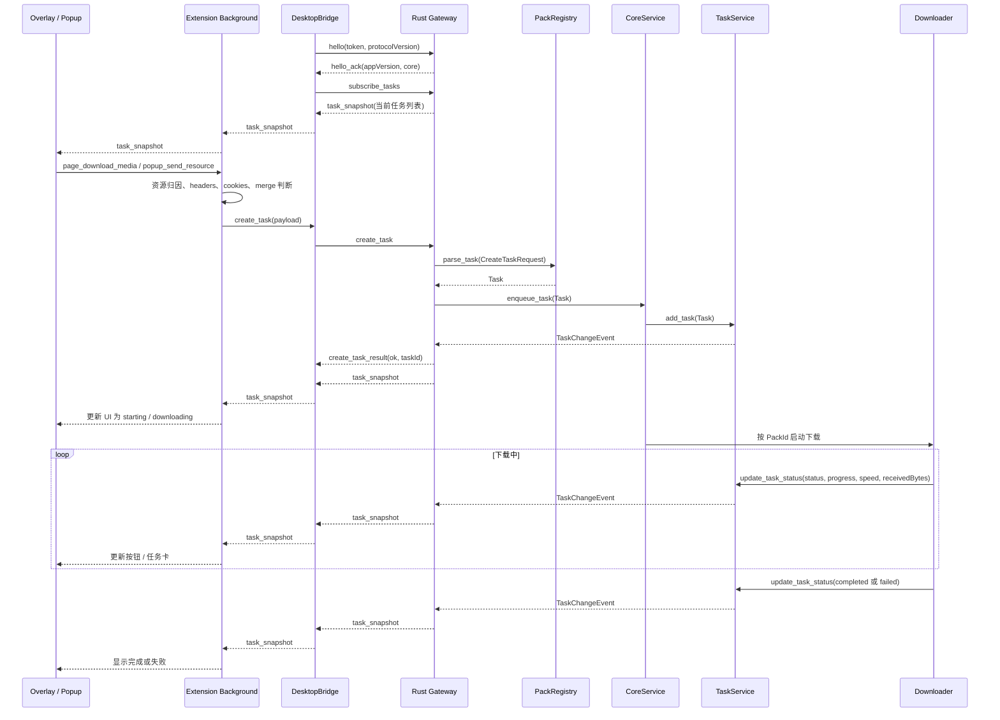

# Ghost Downloader 前后端架构流程图

> 当前状态提示：本文保留为历史架构参考，其中“通过 WebSocket 创建任务、订阅任务快照”的主线描述已过期。当前正式主线以 `current-architecture-10-point-audit-and-roadmap.md` 和 `docs/adr/0001-http-commands-sse-task-events.md` 为准：HTTP commands 创建/控制任务，SSE task events 观察任务，前端常规 UI 更新使用 `task_updated` 增量消息，legacy WebSocket 只作为兼容入口。

这份文档把当前架构拆成三张图来看：

1. 纯后端：Rust daemon 内部如何接收任务、选择 Pack、调度下载、更新任务状态。
2. 纯前端：浏览器扩展内部如何捕获页面媒体、展示 popup/overlay、维护扩展侧状态。
3. 前后端通信：扩展和 daemon 如何通过 WebSocket 创建任务、订阅任务快照、事件驱动更新 UI。

---

## 1. 纯后端流程图

这张图只看 Rust daemon 内部，不包含浏览器扩展。核心原则是：`TaskService` 是任务数据所有者，`CoreService` 只负责队列和并发调度，`PackRegistry` 负责把输入请求解析成具体任务，`DownloadExecutor` 是唯一执行入口。

```mermaid
flowchart TD
    classDef gateway fill:#f9f9f9,stroke:#424242,stroke-width:2px;
    classDef registry fill:#fff3e0,stroke:#f57c00,stroke-width:2px;
    classDef service fill:#e1f5fe,stroke:#0288d1,stroke-width:2px;
    classDef pack fill:#f3e5f5,stroke:#8e24aa,stroke-width:2px;
    classDef engine fill:#e8f5e9,stroke:#388e3c,stroke-width:2px;
    classDef event fill:#fffde7,stroke:#fbc02d,stroke-width:2px;

    Input([CreateTaskRequest<br>url / headers / resources / cookies]) ::: gateway
    Gateway[WebSocket Gateway<br>server.rs] ::: gateway
    Registry{PackRegistry<br>按注册顺序匹配 Pack} ::: registry

    subgraph Packs["Feature Packs: 把请求解析成带 execution_kind 的 Task"]
        direction TB
        Bili[BiliApiParser<br>B 站页面 / DASH] ::: pack
        Youtube[YoutubeDownloader<br>YouTube 页面] ::: pack
        Hls[HlsDownloader<br>m3u8 / HLS] ::: pack
        GenericMerge[GenericMergePack<br>扩展传入 video + audio] ::: pack
        BitTorrent[BitTorrentPack<br>magnet / torrent] ::: pack
        Http[HttpPack<br>普通 HTTP 兜底] ::: pack
    end

    Core[CoreService<br>等待队列 / 并发限制 / 调度] ::: service
    Plan[ExecutionPlan<br>来自 Task.execution_kind] ::: service
    Executor[DownloadExecutor<br>统一下载执行入口] ::: engine
    TaskService[(TaskService<br>任务表数据所有者)] ::: service
    ChangeEvent[[TaskChangeEvent<br>任务新增或状态变化]] ::: event

    subgraph Executors["执行层"]
        direction TB
        DashDownloader[DashDownloader<br>视频/音频下载 + FFmpeg 合并] ::: engine
        UniversalDownloader[UniversalDownloader<br>HTTP 分块下载 / HLS 分片下载] ::: engine
        YoutubeExec[Youtube 执行器<br>yt-dlp 解析 + 下载] ::: engine
        TorrentExec[BitTorrent 执行器] ::: engine
    end

    Done([Completed / Failed]) ::: gateway

    Input --> Gateway
    Gateway --> Registry
    Registry --> Bili
    Registry --> Youtube
    Registry --> Hls
    Registry --> GenericMerge
    Registry --> BitTorrent
    Registry --> Http

    Bili --> Core
    Youtube --> Core
    Hls --> Core
    GenericMerge --> Core
    BitTorrent --> Core
    Http --> Core

    Core -->|"add_task"| TaskService
    TaskService --> ChangeEvent

    Core -->|"from_task"| Plan
    Plan --> Executor
    Executor -->|"按 ExecutionKind 执行"| DashDownloader
    Executor -->|"按 ExecutionKind 执行"| UniversalDownloader
    Executor -->|"按 ExecutionKind 执行"| YoutubeExec
    Executor -->|"按 ExecutionKind 执行"| TorrentExec

    DashDownloader -->|"update_task_status"| TaskService
    UniversalDownloader -->|"update_task_status"| TaskService
    YoutubeExec -->|"update_task_status"| TaskService
    TorrentExec -->|"update_task_status"| TaskService

    TaskService -->|"状态变化事件"| ChangeEvent
    ChangeEvent -->|"Gateway 订阅后生成 task_snapshot"| Gateway
    TaskService --> Done
```

### 后端拆解说明

1. **Gateway 只负责协议入口**
   `server.rs` 负责 WebSocket 消息解析、配对、订阅、任务创建 ACK。它不应该长期承载具体站点解析逻辑。

2. **PackRegistry 负责路由**
   `PackRegistry` 按注册顺序调用各个 Pack 的 `matches()` 和 `parse()`。它的输出是带 `execution_kind` 的标准 `Task`，后续调度层不再关心原始请求来自 B 站、HLS 还是普通 HTTP。

3. **CoreService 只负责调度**
   `CoreService` 持有等待队列、运行队列和并发限制。它不直接理解 B 站、HLS、YouTube 或 HTTP 的具体执行细节。

4. **DownloadExecutor 是统一执行入口**
   Pack 显式设置 `Task.execution_kind`，`ExecutionPlan` 从任务中读取执行类型。`DownloadExecutor` 根据 `ExecutionKind` 调用底层 HTTP 下载器、DASH 合并器、HLS 执行器或其他协议执行器。这样统一的是执行入口和计划契约，而不是把所有协议细节塞进调度层。

5. **TaskService 是状态数据源**
   所有任务新增和状态更新最终进入 `TaskService`。它负责内存任务表、防抖刷盘，并发出 `TaskChangeEvent`。

6. **事件驱动快照**
   后端不再固定频率扫描任务表。任务变化时，`TaskService` 发事件；Gateway 收到事件后再取当前任务表生成 `task_snapshot`。

---

## 2. 纯前端流程图

这张图只看浏览器扩展内部，不包含 Rust daemon。扩展内部可以理解成三块：页面脚本、background 桥接层、popup UI。

```mermaid
flowchart TD
    classDef page fill:#f3e5f5,stroke:#8e24aa,stroke-width:2px;
    classDef background fill:#e1f5fe,stroke:#0288d1,stroke-width:2px;
    classDef ui fill:#fff3e0,stroke:#f57c00,stroke-width:2px;
    classDef state fill:#e8f5e9,stroke:#388e3c,stroke-width:2px;

    subgraph Page["网页页面内脚本"]
        direction TB
        Mse[MSE Attribution<br>mse-attribution.js<br>MAIN world] ::: page
        CatCatch[Cat Catch Content Scripts<br>cat-catch-content-script.js<br>content-script.js] ::: page
        Overlay[Media Download Overlay<br>media-download-overlay.js] ::: page
        PageMedia[PageMediaController<br>页面媒体归因 / 选择资源] ::: page
    end

    subgraph Background["Extension Background"]
        direction TB
        Bg[background.ts<br>消息分发入口] ::: background
        ResourceBridge[ResourceBridge<br>资源缓存 / headers / cookies / merge 任务] ::: background
        DesktopBridge[DesktopBridge<br>WebSocket 客户端 / daemon 快照缓存] ::: background
        FeatureBridge[FeatureBridge<br>高级能力开关] ::: background
        MediaBridge[MediaBridge<br>popup 媒体控制面板] ::: background
    end

    subgraph Popup["Popup UI"]
        direction TB
        PopupReact[React Popup<br>任务 / 资源 / 高级 / 设置] ::: ui
        PopupHook[usePopupBridge<br>拉取完整状态 + 监听任务快照] ::: ui
        TaskCard[TaskCard<br>0.0~1.0 进度显示] ::: ui
    end

    LocalState[(chrome.storage<br>token / serverUrl / 开关)] ::: state
    ResourceCache[(Resource Cache<br>tab -> captured resources)] ::: state
    TaskSnapshot[(Task Snapshot Cache<br>daemon 最新任务列表)] ::: state

    Mse --> PageMedia
    CatCatch --> ResourceBridge
    Overlay -->|"page_download_media"| Bg
    Overlay -->|"监听 task_snapshot"| Bg
    PageMedia --> Overlay

    PopupReact --> PopupHook
    PopupHook -->|"popup_get_state / 操作命令"| Bg
    PopupHook -->|"监听 task_snapshot"| Bg
    PopupHook --> TaskCard

    Bg --> ResourceBridge
    Bg --> DesktopBridge
    Bg --> FeatureBridge
    Bg --> MediaBridge

    ResourceBridge --> ResourceCache
    DesktopBridge --> TaskSnapshot
    Bg --> LocalState
    ResourceCache --> Bg
    TaskSnapshot --> Bg
```

### 前端拆解说明

1. **页面层负责“看见媒体”**
   页面脚本运行在网页上下文里，负责发现 `<video>`、MSE appendBuffer、网络资源和当前可下载媒体。

2. **Overlay 负责页面内直接下载体验**
   `media-download-overlay.js` 只处理按钮显示、定位、点击下载、显示任务状态。它不负责后端协议细节。

3. **Background 是扩展内部总线**
   `background.ts` 接收 popup、overlay、content scripts 的消息，然后分发给不同 bridge。

4. **ResourceBridge 负责资源归因和任务 payload**
   它把页面 URL、headers、cookies、video/audio 资源组合成 daemon 能理解的 `create_task` 请求。

5. **DesktopBridge 负责 daemon 连接**
   它持有 WebSocket、连接状态、任务快照缓存，并在收到 `task_snapshot` 后通知 background。

6. **Popup 不再靠任务轮询刷新进度**
   Popup 打开时会拉一次完整状态，之后任务列表主要通过 `task_snapshot` 事件更新。保留低频刷新只是为了资源列表、设置、连接状态等非任务数据兜底。

---

## 3. 前后端通信流程图

这张图只看扩展和 Rust daemon 之间的通信契约。当前主通道是 WebSocket，核心消息是 `create_task`、`subscribe_tasks`、`task_snapshot`。



### 通信契约说明

1. **连接和订阅**
   扩展先发 `hello`，daemon 返回 `hello_ack`。连接确认后扩展发 `subscribe_tasks`，daemon 立即返回一次当前 `task_snapshot`。

2. **任务创建**
   页面 overlay 或 popup 先把请求交给 background。background 通过 `ResourceBridge` 整理 payload，再由 `DesktopBridge` 发 `create_task` 给 daemon。

3. **创建结果和任务状态是两件事**
   `create_task_result` 只表示“任务是否成功入队”。真正的任务状态通过 `task_snapshot` 持续同步。

4. **进度单位**
   前后端公共契约是 `progress: 0.0~1.0`。UI 显示百分比时才乘以 100。

5. **事件驱动**
   任务变化才产生 `TaskChangeEvent`。Gateway 收到事件后生成最新 `task_snapshot`。扩展 background 再把这条 snapshot 分发给 popup 和 overlay。

6. **空闲状态**
   没有任务变化时，daemon 不固定推任务快照。popup 保留低频状态刷新只是扩展内部兜底，不是下载进度主链路。
