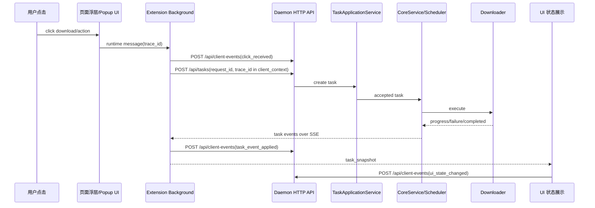

# Ghost Downloader 端到端日志系统完善计划

## 背景

当前后端日志能看到 `create_task`、解析器命中、下载器阶段和任务完成/失败，但还不能回答一个真实排障问题：

用户在浏览器里点了哪一个按钮，点击时 UI 显示什么，background 是否收到点击，是否发出 daemon 请求，daemon 是否接收，任务事件如何变化，最后 UI 为什么显示失败。

这意味着用户看到的失败可能只存在于浏览器扩展 UI 状态里，而后端日志没有关联记录。日志系统必须覆盖完整链路，而不是只记录后端下载器。

## 目标

1. 每一次用户点击都产生可追踪的 `trace_id`。
2. 同一次点击在浏览器扩展、HTTP API、任务服务、下载器、SSE 事件和 UI 状态中使用同一条关联链：`trace_id -> request_id -> task_id -> event_id`。
3. UI 显示状态必须记录，包括按钮忙闲、toast 文案、任务卡状态、浮层按钮状态。
4. 后端必须能接收浏览器扩展侧 telemetry，并写入结构化日志。
5. 日志必须脱敏：不记录 token、cookie、Authorization、完整 headers、加密 cookie、密码或无必要的完整 URL query。

## 链路模型

## 日志类别

| 类别 | 来源 | 必填字段 | 用途 |
| --- | --- | --- | --- |
| `client.click` | popup / overlay | `trace_id`, `action`, `surface`, `tab_id`, `page_origin` | 证明用户点过什么 |
| `client.dispatch` | background | `trace_id`, `request_id`, `source`, `url_host`, `url_path_kind` | 证明扩展发出了什么 |
| `client.dispatch_result` | background | `trace_id`, `request_id`, `task_id`, `ok`, `message` | 证明 daemon 返回了什么 |
| `client.ui_state` | popup / overlay / background | `trace_id`, `task_id`, `surface`, `status`, `visible_text` | 证明 UI 为什么显示失败 |
| `daemon.request` | HTTP API | `request_id`, `trace_id`, `source`, `url_host`, `resource_count` | 证明后端收到了什么 |
| `daemon.task_event` | TaskService/CoreService | `request_id`, `task_id`, `event_id`, `event_type`, `status` | 证明任务状态如何变化 |
| `daemon.download_stage` | Downloader | `request_id`, `task_id`, `stage`, `received_bytes`, `error` | 定位下载器或外部工具失败 |

## Phase 1：闭合真实点击排障链路

本阶段必须完成，解决当前 X 视频排障问题。

1. 新增后端端点 `POST /api/client-events`。
2. 新增前端 telemetry client，支持批量/失败静默上报。
3. 浮层按钮点击时生成 `trace_id`，记录：
   - 点击开始
   - 解析状态变化
   - 发送到 background
   - daemon 返回结果
   - UI 显示失败/完成/获取任务失败
4. Popup 资源下载、合并、任务操作记录：
   - 点击开始
   - background 返回
   - toast 文案和 tone
   - busy 状态变化
5. Background 记录：
   - `createTask` 请求开始/成功/失败
   - task snapshot 广播摘要
   - SSE task event 应用结果
   - task event stream 断开和重试
6. 后端日志写入：
   - tracing 结构化日志
   - `logs/client-events.jsonl`，用于跨重启排障

验收标准：

1. 用户点一次 X 下载后，可以用一个 `trace_id` 查到点击、请求、任务、事件和 UI 最终状态。
2. 如果 UI 显示失败，日志中必须至少有一个 `client.ui_state` 或 `client.dispatch_result` 解释失败文案来源。
3. 如果 daemon 没收到请求，日志中能停在 `client.click` 或 `client.dispatch`，明确断点在扩展侧。
4. 如果 daemon 收到请求但下载失败，日志中能串到 `task_failed` 和下载器错误。

## Phase 2：任务事件增强

1. `TaskEvent` 增加更细的 stage 语义，例如 `hls_playlist_loaded`、`hls_segment_failed`、`ffmpeg_remux_failed`。
2. 下载器错误必须带 `error_code`、`retryable`、`stage`、`short_reason`。
3. CoreService 更新失败状态时使用真实失败原因，而不是只写 `execution_failed`。
4. `TaskSummary` 增加最近错误摘要，UI 可以直接显示最后失败原因。

## Phase 3：诊断工具

1. 增加 `scripts/diagnose_trace.ps1` 或等价脚本，输入 `trace_id/request_id/task_id` 后汇总：
   - client events
   - daemon logs
   - Memory.log task snapshot
   - output file existence
2. 增加日志轮转，避免 JSONL 无限增长。
3. 增加可选 debug mode，临时记录更多网络摘要，但默认仍脱敏。

## 脱敏规则

1. 不记录 `Authorization`、`cookie`、`set-cookie`、token、加密 cookie、cookie iv。
2. URL 默认只记录 `host`、`path_kind` 和必要路径 ID；query 默认不记录。
3. UI 文案可以记录，但不记录页面正文或大段 DOM。
4. headers 只记录数量和是否存在关键 headers，例如 `has_referer`、`has_origin`、`has_user_agent`。

## 当前执行范围

本次执行 Phase 1。Phase 2 和 Phase 3 在当前真实站点问题复现后继续推进。
